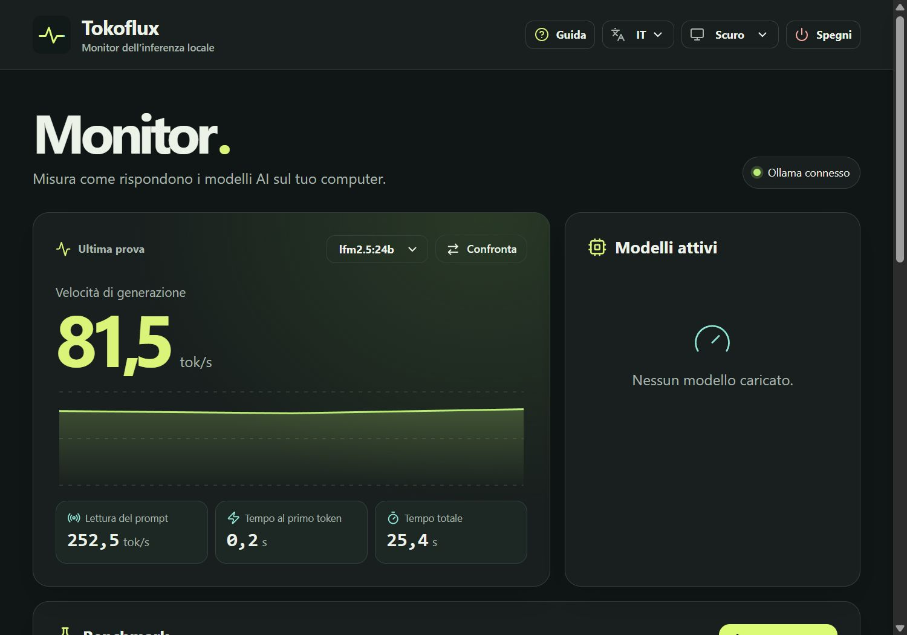

# Tokoflux 0.1.1

Monitor dell’inferenza locale / Local inference monitor



## Avvio su Windows 11

1. Estrai tutto lo ZIP in una cartella, per esempio `Documenti\Tokoflux`.
2. Avvia Ollama come al solito e lascia l’app aperta. Se vuoi solo consultare lo storico, puoi lasciare Ollama spento.
3. Fai doppio clic su **Avvia-Tokoflux.cmd** (oppure, per un'icona sul desktop, esegui una volta **Installa-Tokoflux.cmd**). Tokoflux apre `http://127.0.0.1:8765`. Se lo apri di nuovo, riutilizza il server esistente.
4. In **Benchmark** seleziona i modelli, scegli **A caldo** o **A freddo**, poi premi **Esegui prova**. I risultati si salvano automaticamente.
5. Per fermare Tokoflux premi **Spegni** in alto a destra nell'app: la finestra del launcher si chiude da sola.

**Disinstallare:** esegui **Disinstalla-Tokoflux.cmd**. Rimuove il collegamento dal desktop, poi ti chiede se eliminare anche lo storico/dati (`%LOCALAPPDATA%\Tokoflux`) e la cartella dell'app.

Serve `uv` nel PATH. Il launcher usa Python 3.12 (lo stesso ambiente usato durante la prova OpenCode). Se Python 3.12 non è già nella cache di uv, il primo avvio può richiedere Internet per installarlo. Il frontend è precompilato: per l’uso non servono Node, npm o modelli aggiuntivi.

**Dati:** `%LOCALAPPDATA%\Tokoflux\history.sqlite3`. Tokoflux salva le metriche e non conserva il testo generato. Lingua e tema si conservano nel profilo del browser. Il server ascolta solo su questo PC e usa Ollama su `127.0.0.1:11434`.

**PWA (facoltativa):** con il launcher attivo, apri la stessa pagina in Edge e usa **App → Installa questo sito come app** nel menu del browser. La finestra dedicata richiede comunque il launcher attivo per leggere SQLite o lanciare benchmark.

## Misure

- I modelli partono in sequenza sullo stesso prompt, con un contesto configurabile (2.048–32.768 token, predefinito 8.192) e un limite di 2.048 token generati. Una prova segnala il raggiungimento del limite nel confronto.
- **A caldo** precarica il modello prima di avviare il cronometro. **A freddo** scarica il modello dalla memoria prima della prova; la cache del sistema operativo può comunque conservare dati dell’SSD.
- Il **primo token** è il primo frammento di risposta o ragionamento ricevuto in streaming. Il **tempo totale** è misurato dal server Tokoflux. I token/s provengono dai conteggi e dai tempi di Ollama. A caldo, la cache del prompt può incidere sulla misura.
- La **quota del modello sulla GPU** rappresenta la memoria del modello allocata sulla GPU secondo Ollama. Il carico istantaneo della Radeon è una misura diversa.
- La prima versione monitora le richieste di benchmark inviate da Tokoflux.

## Novità 0.1.1 / What’s new in 0.1.1

- Pannello **Guida/Help** in alto (non blocca il benchmark) e pannello **Mostra il prompt** in Benchmark, entrambi con **Copia**. Il prompt è letto dal server come unica fonte e resta in inglese.
- Footer con versione, autore **Rosario Moscato** (https://rosmoscato.xyz) e claim «handcrafted by a human, upgraded by agents».
- In **Ultima prova** puoi selezionare un modello dell’ultimo benchmark (primo per default) e **Confronta** mostra serie distinte e le differenze tra i risultati dello stesso benchmark.
- Ogni nuovo benchmark salva un **ID di sessione** e l’ordine dei modelli. Lo storico SQLite esistente resta leggibile; i risultati senza ID restano consultabili senza raggrupparli.
- **Contesto configurabile** nel Benchmark per ridurre la memoria usata. Una soglia **Memoria GPU** avvisa quando due modelli insieme la superano. La Guida spiega come limitare la GPU con `OLLAMA_NUM_GPU`/`OLLAMA_MAX_VRAM` in caso di errori ROCm su iGPU AMD.
- In **Ultima prova**, **Confronta** mostra i modelli uno contro l’altro con un grafico a barre animato e l’indicazione del vincitore (la tabella di dettaglio resta nel Benchmark).
- **Pulisci storico** (solo i risultati) e **Resetta app** (storico + preferenze, riparte da zero) nella sezione Storico.

## English quick start

Extract the ZIP, start Ollama, then double-click **Avvia-Tokoflux.cmd** (or run **Installa-Tokoflux.cmd** once to get a desktop icon). Keep the launcher window open, or stop Tokoflux anytime with the **Shut down** button in the top-right corner. To uninstall, run **Disinstalla-Tokoflux.cmd**: it removes the desktop icon and, if you confirm, the data (`%LOCALAPPDATA%\Tokoflux`) and the app folder. The included frontend build needs no Node.js at runtime. Select English in the toolbar. Runs are stored locally under `%LOCALAPPDATA%\Tokoflux`. The Edge-installed app still needs the launcher running.

## Sviluppo / Development

Python 3.12, SQLite, React, TypeScript, Vite, Tailwind, shadcn/ui button and Recharts.

```powershell
cd frontend
npm ci
npm run build
cd ..
uv run --no-project --python 3.12 server.py
```

Per eseguire il server senza aprire il browser, aggiungi `--no-browser`.

## Licenza / License

[MIT](LICENSE) © 2026 Rosario Moscato
